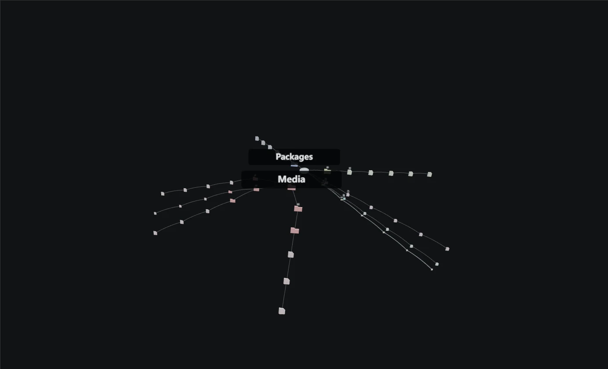

# StorageScope

让磁盘空间从一串数字，变成可以探索、比较和复核的结构。

StorageScope 是一款 Windows 桌面磁盘分析与清理工具。它用目录列表、空间分布和 3D 树帮助定位占用，用快照与差异追踪变化，并在实际清理前复核路径、内容和保留边界。

[](https://github.com/nineanswerer/StorageScope/actions/workflows/checks.yml)



## 功能

- **目录扫描与结构定位**：扫描普通 Windows 目录，查看各层级的逻辑大小与文件数量；支持取消扫描和目录联接环检测。
- **多种结构视图**：列表用于精确查找，空间分布用于比较占用，3D 树用于理解父子关系并逐层下钻。
- **快照与差异**：保存目录状态，比较新增、删除、增长和缩减的文件，以及各目录的净变化。
- **可复核清理**：目录名只作为人工复核线索，不直接宣称“安全删除”；支持参考目录、排除目录和重复组保留项。
- **执行前复核**：重新检查扫描基线、目录清单、文件大小、修改时间和可获取的文件实体身份；发现变化时跳过对应目标。
- **真实空间口径**：区分候选逻辑大小、待清空回收站大小和已核实分配空间释放，不把移入回收站记作已经释放磁盘空间。
- **重复文件合并**：全文哈希确认内容，每组至少保留一个路径；合并后验证硬链接实体，并尽可能核实实际分配空间变化。

## 安全边界

StorageScope 不是根据红色警报替用户决定删除什么的“清理大师”。当前安全策略包括：

- 不清理扫描根本身，不允许路径逃逸出扫描根，并拦截 Windows 系统关键目录和链接越界。
- 参考目录与排除目录同时保护自身、后代和相关祖先目标，前端选择与 Rust 执行层都会检查。
- 分析后发生变化的目录不会被继续整棵删除；无法确认的对象不会被强行处理。
- 删除操作进入回收站，仍可恢复；重复文件组合并至少保留一个路径。
- 快照差异反映文件清单和逻辑大小变化，不等于卷可用空间测量。

这些措施不能替代用户确认，也不代表所有特殊文件系统都已完成验证。实际使用时应先分析副本或非关键目录。

## 下载与版本状态

[下载已发布的 v0.1.0](https://github.com/nineanswerer/StorageScope/releases/tag/v0.1.0)。

`main` 已包含后续的可信清理整改、完整测试和 GitHub 自动检查。发布标签对应发布时的源码；最新本地构建不冒充新的公开 Release。

## 技术栈与结构

- **Rust**：目录遍历、统计、快照、清理计划和文件操作。
- **Tauri 2**：Windows 桌面壳与前后端命令桥接。
- **React + TypeScript**：交互界面与状态管理。
- **Three.js**：3D 目录结构表达。

```text
core/                    核心库：扫描、统计、规则、快照、差异与清理
apps/cli/                命令行入口
apps/desktop/src-tauri/  Tauri 桌面端
ui/                      React / TypeScript 前端
docs/                    阶段记录与项目素材
.github/workflows/       GitHub Actions 自动检查
```

## 本地运行

### 环境准备

- Windows 10/11 x64；
- Node.js 24；
- Rust `stable-x86_64-pc-windows-msvc`，包含 `rustfmt` 与 `clippy`；
- Tauri 2 所需的 Microsoft C++ 生成工具和 WebView2，见[官方环境说明](https://v2.tauri.app/start/prerequisites/)。

### 构建前端并启动桌面端

```powershell
git clone https://github.com/nineanswerer/StorageScope.git
cd StorageScope
cd ui
npm ci
npm run build
cd ../apps/desktop/src-tauri
cargo run
```

### 构建 NSIS 安装包

先完成上述前端依赖安装与构建，再在 `apps/desktop/src-tauri` 中运行：

```powershell
node -e "require('../../../ui/node_modules/@tauri-apps/cli/main.js').run(['build','--bundles','nsis'],'tauri').catch(e=>{console.error(e);process.exit(1)})"
```

安装包输出到 `apps/desktop/src-tauri/target/release/bundle/nsis/`。

## 检查与测试

在仓库根目录运行 Rust 检查：

```powershell
cargo fmt --all -- --check
cargo clippy --workspace --all-targets -- -D warnings
cargo test --workspace
cargo fmt --manifest-path apps/desktop/src-tauri/Cargo.toml -- --check
cargo clippy --manifest-path apps/desktop/src-tauri/Cargo.toml --all-targets -- -D warnings
cargo test --manifest-path apps/desktop/src-tauri/Cargo.toml
```

在 `ui` 目录运行前端检查：

```powershell
npm run lint
npm run test:model
npm run build
```

当前自动化覆盖 **29 项 Rust 核心测试、2 项桌面测试和 14 项前端模型测试**。GitHub Actions 会在推送到 `main`、提交 Pull Request 或手动触发时运行这些检查，但不自动发布安装包。

## 验证记录与限制

- 在一个包含 **307,630 个文件、78.9 GB** 的真实目录上完成过扫描与结构展示验证。一次自动化流程约 24 秒，但包含固定等待，不是稳定的性能基准。
- 在本机真实桌面调试窗口和隔离测试目录中，验证了变化目录完整跳过、参考与排除保护、回收站结果、结果快照比较、硬链接合并，以及执行后候选状态重算。
- 3 个各 2.0 MiB 的重复路径合并后仍全部存在并共享文件实体，本次样本核实释放 4.0 MiB 分配空间。
- 尚未覆盖多设备或第三方环境复现、所有特殊文件系统、回收站清空后的卷余量测量及普遍性能结论。

更多设计与验证细节见 [DESIGN.md](DESIGN.md) 和[项目复盘](https://nineanswerer.github.io/writing/storagescope-case-study/)。

## 参与与贡献分工

提交改动前请运行上述检查；涉及清理逻辑时，应同时补充自动化测试和隔离目录中的实景复核。

九术主导产品定义、交互决策与真实场景验收，AI 协作代码实现、调试和文档整理。项目不表述为全部代码均由个人独立手写。
